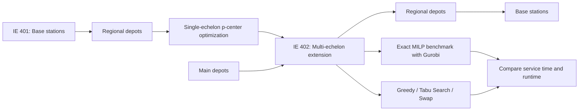

# Vodafone Logistics Network Optimization

**Industrial Engineering Senior Design I & II (IE 401–402) | Özyeğin University | 2024–2025**  
**Industry collaboration:** Vodafone Türkiye  
**Focus:** Facility Location · Operations Research · Mixed-Integer Linear Programming · Heuristic Optimization · Decision Support

> **A two-semester capstone project exploring how to design an efficient, geographically resilient logistics network for telecommunications infrastructure — from a single-echelon p-center model to a multi-echelon model with exact and heuristic solution methods.**

## Project at a glance

| Scope | Details |
|---|---|
| Business context | Supporting logistics and maintenance for a nationwide telecom base-station network (~30,000 sites) |
| Senior Design I (Fall 2024) | Single-echelon **p-center** optimization of depot locations and station assignments |
| Senior Design II (Spring 2025) | **Multi-echelon** network with main depots, regional depots and base stations |
| Optimization | Minimize the **maximum** distance (IE 401) or estimated end-to-end service time (IE 402) |
| Approaches | Exact mixed-integer optimization (Gurobi), Greedy, Greedy + Tabu Search, Greedy + Swap |
| Stack | Python, Gurobi/GurobiPy, pandas, NumPy, geographic distance calculations, K-Means clustering |

## The business problem

Telecommunications infrastructure relies on reliable distribution of maintenance equipment and spare parts. A network with widely dispersed base stations faces a difficult trade-off: concentrating inventory in fewer facilities may simplify operations, but creates long service routes for remote stations. Our capstone studied **where facilities should be located and which sites they should serve** to improve geographic accessibility and worst-case coverage.

This work is a **research and decision-support prototype**, not a production deployment. Reported performance improvements refer to experimental optimization scenarios, not observed changes to Vodafone's operating network.

## How the project evolved across two semesters

### Phase 1 — IE 401: Single-echelon facility location

We formulated a **p-center** optimization problem: select a fixed number of depot sites and assign each base station to exactly one selected depot while minimizing the longest assignment distance. The team constructed geographic distance matrices using the **Haversine** formula and solved the model using Python and Gurobi.

- **Network context:** 30,144 base stations in the project documentation.
- **Computational sample:** 1,044 station locations and an approximately **1,044 × 81** distance matrix.
- **Sensitivity analysis:** Scenarios with **1–15 depots**, assessing maximum distance, average distance, and average distance for the farthest 10% of stations.

**Selected IE 401 scenario results** (approximate distances reported in the study):

| Coverage metric | 1 depot | 15 depots |
|---|---:|---:|
| Maximum station-to-depot distance | 848 km | 176 km |
| Mean station-to-depot distance | 498 km | 113 km |
| Mean distance for farthest 10% | 744 km | 168 km |

The maximum modeled assignment distance decreased by **~79% between the one-depot and fifteen-depot scenarios**. Gains diminished as the number of depots increased, with the study discussing diminishing returns around eight depots. **Eight is not a proven cost-optimal number:** facility opening and operating costs were not explicitly optimized.

### Phase 2 — IE 402: Multi-echelon network and algorithm benchmarking

The second semester extended the problem into a **two-tier network**:

**Main depot → Regional depot → Base station**

Rather than minimizing a direct geographic distance, the extended formulation minimized the **maximum modeled service time** across the complete path. The experiments considered **1,000 base stations, 30 candidate depots, and 10 candidate main depots**, with clustering used to reduce candidate sets for some experiments.

We implemented a **mixed-integer linear programming (MILP)** formulation in Python/Gurobi as an exact-method benchmark and evaluated three alternative heuristics:

1. **Greedy:** rapidly builds an initial feasible network.
2. **Greedy + Swap:** iteratively tests location exchanges to improve the initial solution.
3. **Greedy + Tabu Search:** explores improved combinations while discouraging repeated moves.

The model converted great-circle distances into approximate travel-time inputs using assumed average speeds of **30 km/h** (regional depot to station) and **90 km/h** (main depot to regional depot). These are **simplifying assumptions**, not measured road-route times.

## Results — quality versus computation time

The IE 402 study compared eight depot configurations. The table below gives three representative examples from the reported experimental results; **lower maximum service time is better**.

| Main depots / regional depots | Exact benchmark (hours) | Greedy (hours) | Greedy + Tabu (hours) | Greedy + Swap (hours) |
|---|---:|---:|---:|---:|
| 2 / 4 | 13.64 | 19.16 | 13.87 | 13.87 |
| 2 / 8 | 10.91 | 14.10 | 11.25 | 12.21 |
| 3 / 10 | 9.35 | 11.78 | 9.82 | 10.27 |

**Main finding:** Greedy + Tabu Search consistently improved on the simple Greedy baseline and produced modeled service times close to the exact benchmark in the reported scenarios. Across the eight scenarios, its gap to the benchmark was approximately **1–6%**, calculated from the reported objective values. Reported runtime was approximately **80–203 seconds** for Greedy + Tabu versus **415–1,087 seconds** for the exact method (Greedy alone: roughly **0.01–0.04 seconds**). The methods trade off solution quality and compute time; none is universally fastest *and* best.

> **Interpretation note:** The IE 401 distance results and IE 402 service-time results use different objectives, samples and network formulations; their headline values should not be compared as a before/after operational performance measure.

## Modeling decisions and constraints

| Dimension | IE 401 | IE 402 |
|---|---|---|
| Network | Base station → depot | Base station → depot → main depot |
| Objective | Minimize worst-case assigned distance | Minimize worst-case estimated two-leg service time |
| Optimization variables | Open depots; assign stations | Open both facility tiers; assign stations to depots and depots to main depots |
| Core constraints | Each site assigned once; assignment only to open depot; fixed depot count | Same principles extended to both hierarchy levels |
| Solution approach | Exact p-center model, scenario analysis | Exact MILP benchmark plus three heuristics |

The mathematical models emphasized **worst-case coverage**, rather than just average distance, to avoid neglecting the most remote demand points.

## What I learned

This project linked **operations research, mathematical modeling, geospatial data preparation, algorithm design, and analytical decision-making**. In particular, the transition from IE 401 to IE 402 shows how a mathematically appealing model must sometimes be adapted when network complexity makes exact optimization computationally expensive.

**Team contribution:** This was a six-person group project. I contributed to the problem formulation and optimization-model framework; the full set of individual responsibilities can be expanded separately where verified.

## Limitations and future improvements

- The model used **sampled instances**, not a solved full ~30,000-station nationwide optimization at deployment scale.
- **Haversine distance and fixed average speeds** approximate travel; road networks, congestion, weather and site accessibility were not modeled directly.
- **Inventory availability, depot capacities, opening costs, demand volatility and emergency disruptions** would require additional constraints and data.
- The study did **not** establish realized operational savings, carbon-emission reductions, or measured response-time improvements.
- Potential extensions include testing on larger datasets, robust/seasonal travel-time modeling and capacity-aware multi-echelon allocation.

## Academic context and attribution

**Institution:** Özyeğin University, Department of Industrial Engineering  
**Courses:** IE 401 (Fall 2024) and IE 402 (Spring 2025)  
**Supervisor:** İsmail Başoğlu  
**Project team:** Başak Özen, Yaren Yalçın, Kıvanç Ali Turan, Talatcan Gültekin, Kerem Sezener, Bihter Mürya Paşalı

## Publication notice

This repository is a **public-facing, independently written technical summary** of an academic capstone. **The original source code, notebooks, underlying datasets and full academic reports are not distributed here** in accordance with sharing restrictions. Numbers and conclusions are identified as *academic experimental results*, not claims of a deployed commercial solution. Company affiliation describes the project's industry collaboration and does not imply endorsement.
