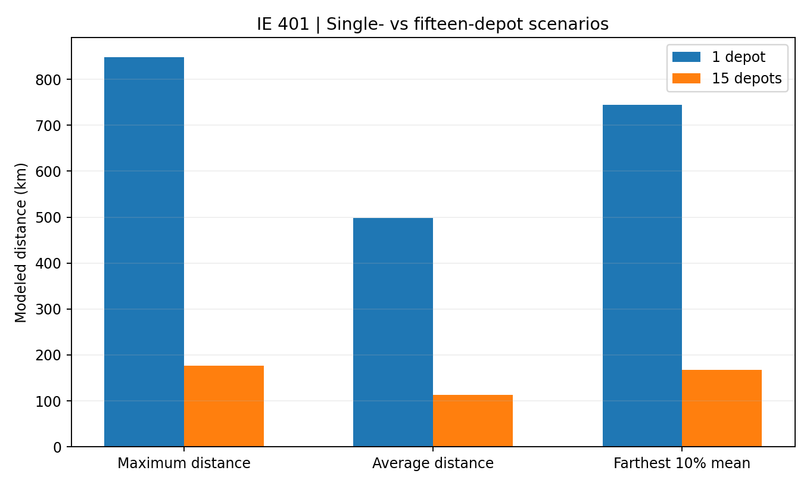

# Senior Design I — IE 401 (Fall 2024)

## Research question
How should a fixed number of candidate depots be selected to minimize the **largest straight-line distance** between any base station and its assigned depot?

## Formulation
The project uses a **single-echelon p-center model**. Let *i* index sampled base stations and *j* index depot candidates. Let `d_ij` denote Haversine distance, `x_ij` assignment, `y_j` facility opening, `p` selected depot count and `Z` maximum assigned distance.

**Minimize** `Z`, subject to:

- Each base station is assigned to exactly one depot: `sum_j x_ij = 1`.
- Assignments require an opened depot: `x_ij <= y_j`.
- Exactly `p` depots are opened: `sum_j y_j = p`.
- The maximum covers every assigned station: `sum_j d_ij*x_ij <= Z` for each `i`.
- `x_ij` and `y_j` are binary.

## Data preparation and experiments
- Broad business context: **30,144 base stations**. The optimization experiments used **1,044 sampled station locations**.
- Geographic distances were computed with the **Haversine formula**; the reported matrix was approximately **1,044 × 81** (station-by-city/candidate).
- **Python, pandas and Gurobi** were used for distance preparation and solving.
- **15 depot-count scenarios** (1 to 15) measured maximum, average and farthest-decile mean distances.

| Metric | 1 depot | 15 depots |
|---|---:|---:|
| Maximum assigned distance | ~848 km | ~176 km |
| Average assigned distance | ~498 km | ~113 km |
| Farthest 10% mean distance | ~744 km | ~168 km |

The **~79% drop in maximum distance** is a comparison of modeled **1-depot and 15-depot scenarios**, *not* a measured change to Vodafone’s actual logistics. Results suggest diminishing marginal improvements around eight depots, but opening costs were not modeled: this is **not proof that eight depots is financially optimal**.

## Assumptions and limitations
Haversine rather than road distance; equal location-opening cost; no capacity and inventory constraints; candidate sites assumed feasible; results on a reduced sample. The model was **not deployed**.

**Source:** Team's IE 401 capstone report, especially modeling (pp. 20–22) and computational results (pp. 24–29). The original report and code are not shared.
