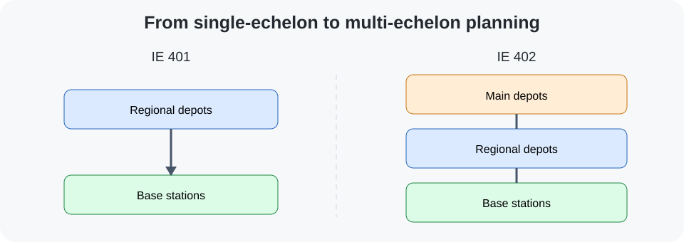
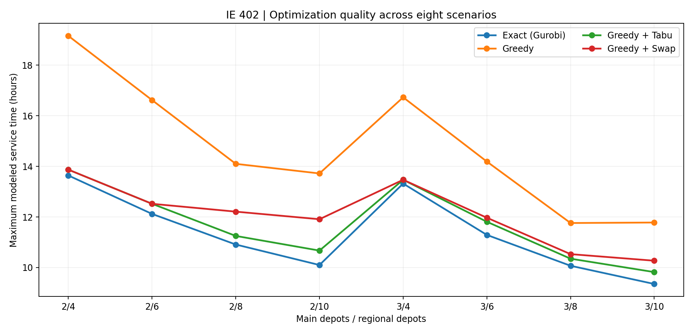
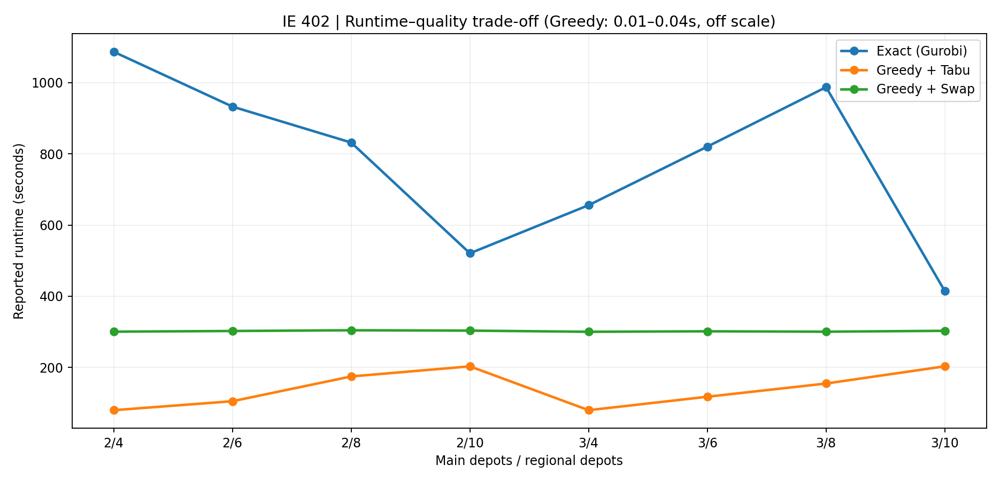

# Senior Design II — IE 402 (Spring 2025)

## Why the model changed
IE 401 considered one tier of depots. IE 402 extended the network into **main depots → regional depots → base stations**, optimizing the **worst-case estimated travel/service time across both legs**. This creates a larger facility-selection and assignment problem, making algorithmic runtime a central design issue.

## Model and experimental design
- Test instance: **1,000 base stations, 30 candidate depots, 10 candidate main depots**. (The mathematical-model indexing section also mentions 1,044; the computational results section reports 1,000.)
- Exact-method benchmark: **mixed-integer linear programming (MILP)** with **Python/Gurobi**.
- Decisions: which regional and main depots to open; which station uses which regional depot; and which regional depot uses which main depot.
- Constraints include exclusive assignment, assignments only to open facilities, and fixed counts for the two tiers.
- A K-Means preprocessing approach was described for reducing the candidate sets to representatives of **10 regional-depot clusters** and **5 main-depot clusters** in certain experiments.
- Haversine distances were converted into approximate time with **30 km/h** (depot to station) and **90 km/h** (main depot to depot) assumed speeds. These are proxies, not measured driving times.

## Four approaches
1. **Exact Gurobi MILP:** benchmark used for solution-quality comparisons.
2. **Greedy:** fast initial site selection, then assignments.
3. **Greedy + Tabu Search:** local exploration with a tabu list to discourage revisiting moves, intensification and diversification.
4. **Greedy + Swap:** local search that exchanges opened and candidate facility sites.

## All eight reported scenarios

**Maximum modeled service time (hours; lower is better)**

| Main / regional depots | Exact | Greedy | Greedy + Tabu | Greedy + Swap |
|---|---:|---:|---:|---:|
| 2 / 4 | 13.64 | 19.16 | 13.87 | 13.87 |
| 2 / 6 | 12.12 | 16.62 | 12.52 | 12.52 |
| 2 / 8 | 10.91 | 14.10 | 11.25 | 12.21 |
| 2 / 10 | 10.10 | 13.72 | 10.67 | 11.91 |
| 3 / 4 | 13.32 | 16.73 | 13.47 | 13.47 |
| 3 / 6 | 11.29 | 14.19 | 11.81 | 11.97 |
| 3 / 8 | 10.07 | 11.76 | 10.35 | 10.53 |
| 3 / 10 | 9.35 | 11.78 | 9.82 | 10.27 |

**Runtime (seconds; reported)**

| Main / regional depots | Exact | Greedy | Greedy + Tabu | Greedy + Swap |
|---|---:|---:|---:|---:|
| 2 / 4 | 1086.60 | 0.02 | 80.10 | 300.61 |
| 2 / 6 | 932.65 | 0.04 | 105.29 | 302.53 |
| 2 / 8 | 831.73 | 0.04 | 174.82 | 304.51 |
| 2 / 10 | 520.71 | 0.03 | 203.21 | 303.56 |
| 3 / 4 | 655.88 | 0.01 | 80.09 | 300.31 |
| 3 / 6 | 820.36 | 0.04 | 117.90 | 301.64 |
| 3 / 8 | 987.25 | 0.02 | 155.00 | 300.54 |
| 3 / 10 | 414.56 | 0.03 | 203.33 | 303.01 |

The **Greedy + Tabu** approach delivered modeled objective values roughly **1–6% above the exact benchmark** in the eight configurations, while consuming less time. Plain Greedy was substantially faster, but had notably poorer objective values. These are *sampled experimental comparisons*, not field measurements.

## Study boundaries
The original nationwide network was **not optimized end-to-end at full scale**. No implementation is claimed. Capacity, inventory, budget, road routing, congestion and seasonal variability were outside this version's core model. The report occasionally uses inconsistent counts and interchanges P/R notation; this summary uses **main depots / regional depots** throughout, consistent with the computational-results tables.

**Source:** Team's IE 402 capstone report, especially modeling (pp. 12–18), computational results (pp. 19–21) and conclusions (pp. 23–24). Full paper and source code are not shared.
